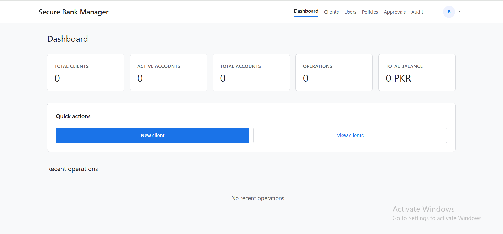
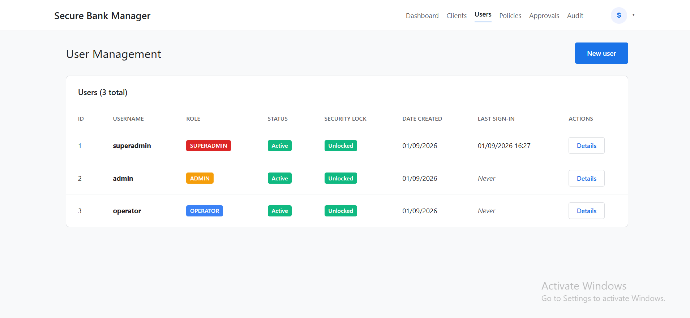

<div align="center">

# 🏦 Secure Bank Manager

An educational Flask banking-management application with secure authentication, MFA, role-based access control, configurable policies, maker-checker approvals, transactional account operations, and a tamper-evident audit chain.


</div>

---

## 📌 Project Overview

**Secure Bank Manager** is a local banking-operations prototype built to demonstrate secure Python web-application design. It provides staff authentication, role-based permissions, TOTP multi-factor authentication, client and account workflows, policy-driven transaction controls, maker-checker approval, and HMAC-backed audit logging.

The application uses fictional client records, PKR balances, SQLite persistence, Asia/Karachi timezone settings, and server-rendered Jinja templates. It is designed to be understandable and runnable by a junior Python developer.

---

## ✨ Features

### 🔐 Authentication and Access Control

- Session-based login with generic authentication errors
- Account lockout after repeated failed password attempts
- Role-based workflows for operator, administrator, and superadministrator users
- TOTP MFA enrollment with Google Authenticator-compatible QR codes
- One-time recovery codes for account recovery
- Separate rate limits for login, MFA verification, and recovery endpoints
- CSRF protection for state-changing requests
- Session timeout and POST-only logout

### 💳 Account Operations

- Fictional client and account management screens
- Decimal-safe PKR balance calculations
- Deposits and withdrawals with configurable policy limits
- Minimum opening and minimum remaining balance rules
- Atomic withdrawal-velocity and daily-limit enforcement
- Account close and reopen workflows
- Panic mode for temporarily restricting sensitive operations

### ✅ Maker-Checker Workflow

- High-value withdrawals can require explicit approval
- The maker cannot approve their own request
- Atomic approval claiming prevents duplicate execution
- Approval, rejection, and withdrawal actions are audited

### 🧾 Tamper-Evident Audit Chain

- Canonical event payloads signed with HMAC-SHA256
- Unique event identifiers and monotonic sequence numbers
- Audit events commit with the related business transaction
- Verification detects modified records and missing interior sequence numbers
- Local audit anchors document the latest verified event

### 🖥️ Operational Interface

- Role-aware dashboard with recent operations and balance statistics
- Client, account, user, policy, approval, and audit screens
- Responsive English interface
- Local MFA setup and recovery-code display
- Centralized policy administration with change history

---

## 🖼️ Screenshots

| Dashboard |
| --- |
|  |

| User management |
| --- |
|  |

---

## 🧰 Tech Stack

### Core Python

- Python 3.13+
- Flask 3.1 application factory
- Jinja server-rendered templates
- SQLAlchemy 2 ORM
- SQLite with serialized write transactions

### Security and Operations

- Flask-WTF CSRF protection
- Flask-Limiter endpoint rate limits
- Passlib/bcrypt password hashing
- PyOTP TOTP MFA
- QRCode and Pillow for MFA enrollment
- HMAC-SHA256 audit-chain signing

### Quality Assurance

- pytest
- 30 automated tests
- Python compilation checks
- Temporary isolated SQLite databases for tests
- Docker and Gunicorn support

---

## 📁 Folder Structure

```text
Secure-Bank-Management/
├── docs/
│   └── screenshots/
│       ├── dashboard.png
│       └── users.png
├── src/                 # Flask application modules
├── templates/           # Jinja pages and components
├── static/              # CSS, JavaScript, and vendor assets
├── tests/               # Security, policy, MFA, audit, and transaction tests
├── scripts/             # Setup and development helpers
├── data/.gitkeep        # Runtime database directory placeholder
├── .env.example
├── Dockerfile
├── docker-compose.yml
├── requirements.txt
├── LICENSE
└── README.md
```

Runtime databases, secrets, virtual environments, caches, and generated files are excluded from Git.

---

## 🔐 Environment Variables

Copy `.env.example` to `.env`. Generate two different random values and keep them private:

```env
SECRET_KEY=<random-value-at-least-32-characters>
HMAC_SECRET_KEY=<different-random-value-at-least-32-characters>
APP_ENV=development
DATABASE_PATH=data/secure_bank_manager.db
AUTO_INITIALIZE_DATABASE=0
CURRENCY=PKR
TIMEZONE=Asia/Karachi
SESSION_COOKIE_SECURE=0
SESSION_COOKIE_SAMESITE=Lax
```

Production mode rejects missing, identical, default, or short Flask and HMAC keys. Use `SESSION_COOKIE_SECURE=1` when serving through HTTPS.

---

## 🚀 Getting Started on Windows

### Prerequisites

- Windows 10 or Windows 11
- Python 3.13 or newer
- Internet access for the initial dependency installation

### 1. Create the Environment

Use **Windows Command Prompt (CMD)** from the project root:

```bat
cd /d "D:\Resumes\Projects\Python\Projects\New folder\Secure-Bank-Management"
python -m venv secure_bank_manager_env
call secure_bank_manager_env\Scripts\activate.bat
```

### 2. Install Dependencies

```bat
python -m pip install --upgrade pip setuptools wheel
python -m pip install -r requirements.txt
python -m pip check
```

### 3. Configure Secrets

```bat
copy .env.example .env
python -c "import secrets; print(secrets.token_hex(32))"
python -c "import secrets; print(secrets.token_hex(32))"
notepad .env
```

Put the first generated value in `SECRET_KEY` and the second in `HMAC_SECRET_KEY`.

### 4. Create the Database and Demo Users

```bat
python scripts\seed_dev_users.py --strength
```

The command prints one-time random passwords for `superadmin`, `admin`, and `operator`. Store them securely; they are not printed again.

### 5. Run the Tests

```bat
python -m compileall -q src scripts tests
python -m pytest -q
```

Expected result:

```text
30 passed
```

### 6. Start the Application

```bat
python -m flask --app src.app:create_app run --host 127.0.0.1 --port 5000
```

Open <http://127.0.0.1:5000> and sign in with one of the credentials printed by the seed command.

Press `Ctrl+C` to stop Flask, then run `deactivate` to leave the virtual environment.

---

## 🧪 Tests and Verification

```bat
python -m pip check
python -m compileall -q src scripts tests
python -m pytest -q
```

The isolated suite covers authentication, MFA rate limits, CSRF, role permissions, session timeout, policy/UI consistency, competing withdrawals, velocity limits, audit integrity, audit rollback, maker-checker races, panic mode, and project safety. Tests use temporary SQLite databases and do not modify the development database.

---

## 🔑 MFA Recovery Codes

During first login, administrator and superadministrator accounts are guided through MFA setup. Scan the QR code with Google Authenticator and enter the current six-digit code.

The displayed recovery codes are one-time emergency codes. Store them securely in a password manager. Each code becomes invalid after use and should never be shared.

---

## 🐳 Docker

```bat
docker compose up --build
docker compose down
```

The container runs as a non-root user, publishes only on host loopback, uses a standard-library healthcheck, and runs one Gunicorn worker because SQLite writes are serialized locally.

---

## ⚠️ Scope and Limitations

- This is a local educational prototype, not a production banking system.
- SQLite and the in-process limiter are intended for bounded local use.
- The application requires secure secret configuration outside testing mode.
- Fictional records and PKR balances are used for demonstrations.
- An external audit anchor is required to detect complete database deletion or tail truncation.

---

## 🧑‍💻 Author

**Muhammad Ali Nawaz**  
Python Developer

---

## 📄 License

Copyright © 2026 Muhammad Ali Nawaz.

This project is licensed under the [MIT License](LICENSE).

---

<p align="center">
  <b>⭐ If this project helps you, consider starring the repository!</b>
</p>
